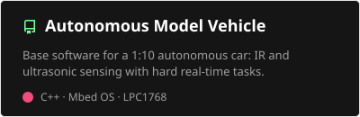
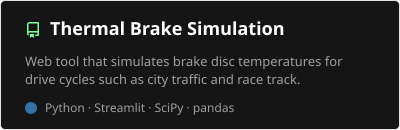
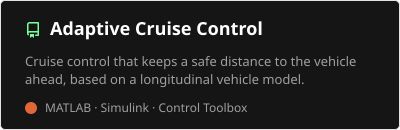
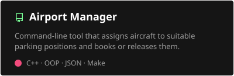

I build systems where **mechanics, electronics and software** meet: from schematics and PCBs to
embedded control, robotics and vehicle testing. Development engineer, M.Sc. student in **Intelligent Systems** and B.Eng. in **Vehicle Mechatronics and Informatics**, both at **Ostfalia University of Applied Sciences**.

## 🎯 What I do

| Focus | Topics |
|---|---|
| 🔧 **Hardware & Embedded** | Schematics and PCB design, BOMs, ARM Cortex-M, UART / SPI / I²C, development up to series production |
| 🤖 **Robotics & AI** | ROS 2, SLAM, Nav2, sensor fusion, speech interfaces, LLM integration |
| 🧪 **Test & Validation** | Test benches, vehicle prototypes, trace analysis, HUD and AR systems |
| 🔌 **Bus Systems & Diagnostics** | CAN / CAN-FD, ECU communication, diagnostics |
| 📐 **Model-Based Development** | MATLAB / Simulink, controller design, simulation tools |

## 🛠 Tech stack

**Languages**

**Embedded & Hardware**

**Robotics & AI**

**Modeling & CAD**

**Automotive**

**Tools**

## 📌 Featured projects

## 📊 GitHub stats

## 🤝 Let's connect

I'm always happy to talk about **embedded systems, robotics and automotive technology**.
The quickest way to reach me is [LinkedIn](https://www.linkedin.com/in/firas-ben-fraj-328a59324/) or [email](mailto:firasbf6@gmail.com).

