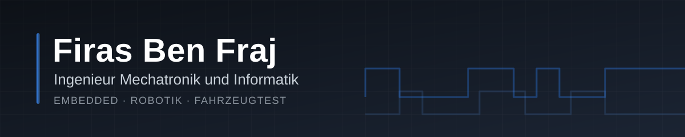

  <a href="https://www.linkedin.com/in/firas-ben-fraj-328a59324/">LinkedIn</a>
  &nbsp;·&nbsp;
  <a href="mailto:firasbf6@gmail.com">firasbf6@gmail.com</a>
  &nbsp;·&nbsp;
  Villingen-Schwenningen

Ich entwickle Hard- und Software für Fahrzeug- und Embedded-Systeme, von der Schaltung über die Firmware bis zur Validierung.
Abschluss **B.Eng. Fahrzeugmechatronik und -informatik** an der Ostfalia Hochschule, berufsbegleitend im **M.Sc. Intelligente Systeme**.

## Aktuell

- **Ingenieur Entwicklung** bei ROMESS-Rogg GmbH + Co. KG: Soft- und Hardware-Produktentwicklung bis zur Serienreife
- **M.Sc. Intelligente Systeme**, Ostfalia Hochschule (seit 03/2026)

## Schwerpunkte

| Bereich | Inhalt |
|:--|:--|
| **Embedded & Hardware** | Mbed OS auf ARM Cortex-M, Schaltplan- und Platinenentwurf (KiCad), Sensorik |
| **Robotik & KI** | ROS 2, SLAM, Nav2; Bachelorarbeit: autonomer Museumsführer auf TurtleBot 4 mit Sprachdialog (LLM) |
| **Fahrzeugtest & Diagnose** | CAN / CAN-FD, CANoe, Prüfstands- und Fahrzeugtests, Trace-Analyse |
| **Modellbasierte Entwicklung** | MATLAB / Simulink, Regelung und Simulation |

## Technologien

| | |
|:--|:--|
| **Sprachen** | `C` `C++` `Python` `MATLAB` |
| **Embedded** | `Mbed OS` `ARM Cortex-M` `UART` `SPI` `I2C` `PlatformIO` |
| **Robotik & KI** | `ROS 2` `Nav2` `SLAM` `LIDAR` `Raspberry Pi` `Azure OpenAI` |
| **Automotive** | `CAN` `CAN-FD` `CANoe` `DLT-Viewer` `ControlDesk` |
| **Tools** | `Git` `Docker` `Linux` `Simulink` `CATIA` `SOLIDWORKS` `KiCad` |

## Projekte

| Projekt | Beschreibung | Technologien |
|:--|:--|:--|
| [**Autonomes Modellfahrzeug**](https://github.com/firas699/Autonomes_Fahren_mbedOS_ARMCortexM3) | Echtzeit-Fahrzeugsteuerung im Maßstab 1:10 auf LPC1768: Sensorik (IR, Ultraschall) im 100-ms-, Aktorik im 20-ms-Takt, Systemmonitor, Querregelung | `C++` `Mbed OS` `ARM Cortex-M3` |
| [**Thermische Bremsscheibenanalyse**](https://github.com/firas699/Thermisches_Bremssimulations-Tool_Paython_Streamlit) | Web-Tool zur thermischen Simulation von Bremsscheiben | `Python` `Streamlit` |
| [**Adaptive Cruise Control**](https://github.com/firas699/Tempomat_Folgefahrt_Simulink_Matlab) | Tempomat mit Folgefahrt, modelliert und simuliert | `MATLAB` `Simulink` |
| [**Temperaturregler**](https://github.com/firas699/Temperaturregler_Matlab_Simulink) | Regelung eines thermischen Systems | `MATLAB` `Simulink` |
| [**Airport Manager**](https://github.com/firas699/Airport_Manager_Airplane_Checking) | Verwaltung von Terminal und Flugzeugabfertigung | `C++` |
| [**Train Manager**](https://github.com/firas699/Train_Manager_Waggon_Eigenschaften) | Zusammenstellung von Zügen aus Waggons mit Eigenschaften | `C++` |

## Kontakt

<<<<<<< HEAD
Für Austausch zu Embedded Systems, Robotik und Fahrzeugtechnik erreichen Sie mich am besten über
[LinkedIn](https://www.linkedin.com/in/firas-ben-fraj-328a59324/) oder per [E-Mail](mailto:firasbf6@gmail.com).
=======
## 📌 Featured projects

## 📊 GitHub stats
>>>>>>> bf70fb7 (New style)

Sprachen: Deutsch (C1) · Englisch (B1) · Französisch (B1) · Arabisch (Muttersprache)
